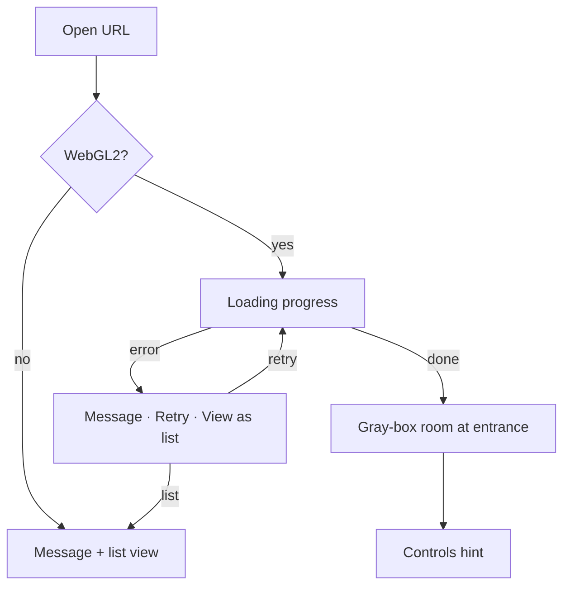

# FEAT-00: Scene foundation + deploy

| Field | Value |
|-------|-------|
| ID | FEAT-00 |
| Wave | A |
| Status | `draft` |
| Flows | [FLOW-00](../FLOWS.md#flow-00--arrive--load), [FLOW-03](../FLOWS.md#flow-03--list-view-fallback--shortcut) (fallback stub) |
| Depends on | — |
| Blocks | All |
| Primary persona | Both |

## Outcome

A live URL from `main` opens a full-screen Three.js scene of an empty gray-box room, with a loading state, an unsupported-3D fallback, and automated build checks on every PR.

## Persona lens

- **P1:** Something appears within seconds; never a blank page.
- **P2:** Works on a phone browser; if 3D can't run, still sees the work list.

## User stories

- (Both) As a visitor, I want to see loading progress so that I know the gallery is coming.
- (Both) As a visitor on an unsupported device, I want a plain explanation and a list of works so that I'm not stuck.
- (Alex) As the builder, I want every PR checked and `main` auto-deployed so that the live demo never breaks.

## Requirements

| ID | Requirement | Trace |
|----|-------------|-------|
| REQ-00-01 | Vite + TypeScript app in `app/` with `dev`, `build`, `preview`, `lint`, `typecheck` scripts | PRD §7 |
| REQ-00-02 | Full-screen canvas; `THREE.WebGLRenderer` (per D-01), resize + device-pixel-ratio cap (≤ 2) | FLOW-00 step 4 |
| REQ-00-03 | Gray-box room: floor, 4 walls, 1 divider, 3–5 empty frame placeholders at fixed positions | PRD §4 |
| REQ-00-04 | Artwork data file `app/src/data/artworks.ts` (id, title, medium, year, narrative, image, position, rotation, link?) | FLOW-02 |
| REQ-00-05 | Loading screen with progress bar wired to Three.js `LoadingManager` | FLOW-00 step 3; shared rule 5 |
| REQ-00-06 | WebGL2 capability check → if missing, show message + list view stub | FLOW-00 step 2 |
| REQ-00-07 | Load error state: message, **Retry**, **View as list** | FLOW-00 step 3 |
| REQ-00-08 | HTML chrome layer above canvas (title, "All works" button) using `docs/ui-patterns.md` stacking | ui-patterns § Page shell |
| REQ-00-09 | GitHub Actions: **PR check** (install, lint, typecheck, build) on PRs to `main` | GIT-WORKFLOW |
| REQ-00-10 | GitHub Actions: **deploy** `app/dist` to GitHub Pages on push to `main` only; Vite `base` set for Pages path | D-03 |
| REQ-00-11 | Quality setting `low` / `medium` / `high` in one config, overridable with `?quality=`; **defaults to `low` in `npm run dev`**, auto-picked in production. Low = DPR 1, no shadows, minimal lights | PRD §6.1 |
| REQ-00-12 | `npm run dev` reachable from a phone on the same Wi-Fi (Vite `--host`) | PRD §6.1 |

## Acceptance criteria

- **Given** a supported browser, **when** I open the live URL, **then** I see progress, then the gray-box room.
- **Given** WebGL2 is unavailable, **when** I open the URL, **then** I see a plain message and the list of works.
- **Given** a PR with a TypeScript error, **when** checks run, **then** the PR check fails.
- **Given** a merge to `main`, **when** the deploy runs, **then** the live URL updates.
- **Given** `npm run dev` on the laptop, **when** the scene loads, **then** it runs in `low` quality unless `?quality=` says otherwise.
- **Given** the dev server is running, **when** I open its network URL on my phone, **then** the scene loads.

## Out of scope

Movement (FEAT-01/02), selection (FEAT-03), real assets (FEAT-04).

## Decisions

D-01 renderer · D-02 framework · D-03 hosting — see [FEATURES.md](../FEATURES.md#decisions-blocking-ready).

## Flow map

## Build handoff

- [ ] Read this file + FLOW-00 + shared rules
- [ ] Resolve D-01, D-02, D-03 (or confirm recommendations)
- [ ] Implement map nodes incl. error + unsupported paths
- [ ] PR check and deploy workflows green
