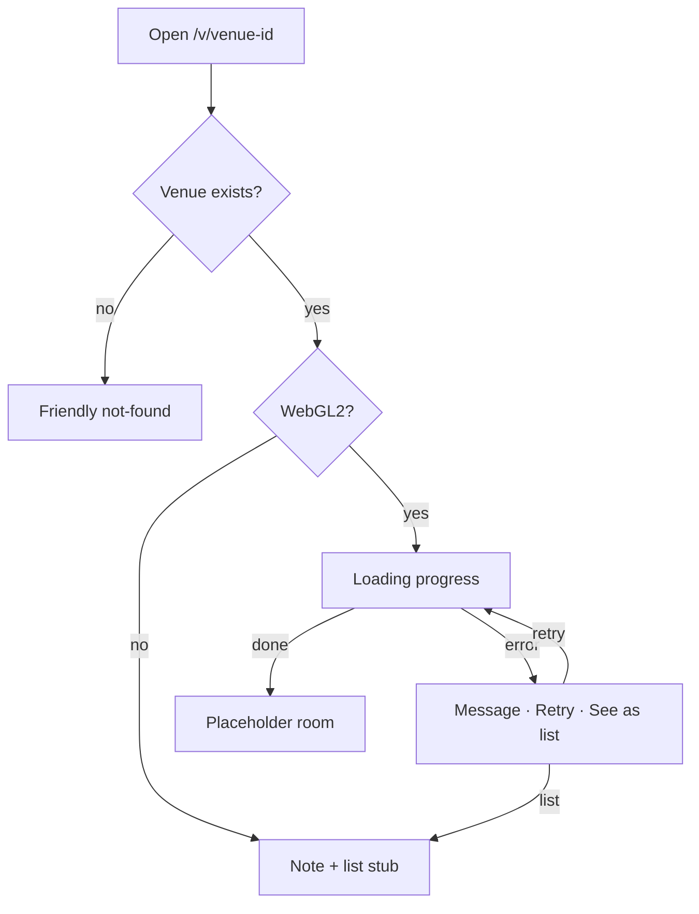

# FEAT-00: Foundation (app, venue links, loading, deploy)

| Field | Value |
|-------|-------|
| ID | FEAT-00 |
| Wave | A |
| Status | `ready` |
| Flows | [FLOW-00](../FLOWS.md#flow-00-owner-opens-the-pitch-p2) steps 1–3, [FLOW-03](../FLOWS.md#flow-03-list-view-p2-fallback--shortcut) (stub) |
| Depends on | — |
| Blocks | All |
| Primary persona | Both |

## Outcome

A live link per venue (e.g. `/v/corner-bistro`) opens a full-screen 3D canvas with loading, error, and unsupported-device states, an empty placeholder room, and automated checks on every PR.

## Persona lens

- **P2 Dana:** something appears within seconds; never a blank or broken page.
- **P1 Alex:** each restaurant gets its own link; the live site never breaks.

## User stories

- (P2) As Dana, I want the link to open quickly and show progress so that I don't give up.
- (P2) As Dana on an older phone, I want a simple list of the pieces if 3D can't run so that I still see the work.
- (P1) As Alex, I want each venue at its own link so that I can send the right pitch to the right restaurant.
- (P1) As Alex, I want every change checked and `main` auto-deployed so that the live link always works.

## Requirements

| ID | Requirement | Trace |
|----|-------------|-------|
| REQ-00-01 | Vite + TypeScript app in `app/` with `dev`, `build`, `preview`, `lint`, `typecheck` scripts | PRD §7 |
| REQ-00-02 | Full-screen canvas; `THREE.WebGLRenderer`; handles resize; pixel-ratio cap per quality setting | D-01 |
| REQ-00-03 | Routing: `/v/<venue-id>` loads `app/src/data/venues/<venue-id>.json`; unknown id → friendly not-found page; `/` → simple placeholder page (no venue list) | FLOW-00 step 1 |
| REQ-00-04 | Data files + types: `site.json` (`artistName: "Alex Farrell"`), `artworks.json`, and one sample venue (`sample-room.json`, a 20 × 15 ft rectangle) matching the PRD data model | PRD §7 data model |
| REQ-00-05 | Loading screen with progress (Three.js `LoadingManager`) | FLOW-00 step 3; shared rule 6 |
| REQ-00-06 | WebGL2 check → if missing, list-view stub with a short note | FLOW-00 step 2 |
| REQ-00-07 | Load error: message, **Retry**, **See the pieces as a list** | FLOW-00 step 3 |
| REQ-00-08 | HTML UI layer above the canvas (stacking per `docs/ui-patterns.md`) | ui-patterns § Page shell |
| REQ-00-09 | **PR check** workflow: install, lint, typecheck, build on PRs to `main` | GIT-WORKFLOW |
| REQ-00-10 | **Deploy to GitHub Pages** from `main` only (Actions workflow: build `app/` → upload `app/dist` → deploy). Vite `base: '/3d-gallery/'` | D-03 |
| REQ-00-10b | Build step generates `dist/v/<venue-id>/index.html` for every venue file, so `/3d-gallery/v/<id>/` works on refresh and when opened from a text (Pages has no server rewrites). Plus a `404.html` with the friendly not-found page | D-03; FLOW-00 step 1 |
| REQ-00-11 | Quality setting `low` / `medium` / `high`, overridable with `?quality=`; **`low` by default in `npm run dev`**, auto-picked in production | PRD §6.1 |
| REQ-00-12 | `npm run dev` reachable from a phone on the same Wi-Fi (Vite `--host`) | PRD §6.1 |
| REQ-00-13 | `<meta name="robots" content="noindex">` so pitch links aren't listed by search engines | D-03 |

## Acceptance criteria

- (P2) **Given** a supported phone, **when** Dana opens `/v/sample-room`, **then** she sees progress, then the placeholder room.
- (P2) **Given** WebGL2 is unavailable, **when** the link opens, **then** a plain note and the list stub show.
- **Given** `/v/does-not-exist`, **when** opened, **then** a friendly not-found page shows.
- (P1) **Given** a PR with a TypeScript error, **when** checks run, **then** the PR check fails.
- (P1) **Given** a merge to `main`, **when** deploy finishes, **then** `alexcat617.github.io/3d-gallery/v/sample-room/` loads, including on refresh.
- **Given** `npm run dev`, **when** opened on the laptop and on a phone via the network URL, **then** both load in `low` quality.

## Out of scope

Real room geometry (FEAT-01), artwork (FEAT-02), viewpoints (FEAT-03).

## Decisions

D-01 renderer · D-02 framework · D-03 hosting (resolved: GitHub Pages, public): see [FEATURES.md](../FEATURES.md#decisions-blocking-ready).

## Flow map

## Build handoff

- [x] D-01 WebGL2 · D-02 plain Three.js + TypeScript · D-03 GitHub Pages (all resolved)
- [ ] One-time on GitHub: **Settings → Pages → Source: GitHub Actions**
- [ ] Implement map nodes incl. not-found, unsupported, error
- [ ] PR check + deploy green
