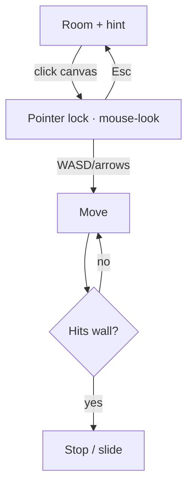

# FEAT-01: Desktop movement + collision

| Field | Value |
|-------|-------|
| ID | FEAT-01 |
| Wave | A |
| Status | `draft` |
| Flows | [FLOW-01](../FLOWS.md#flow-01--move--explore) |
| Depends on | FEAT-00 |
| Blocks | FEAT-03, FEAT-05 |
| Primary persona | **P1** Riley |

## Outcome

On desktop, the visitor walks the room with WASD/arrows and looks around with the mouse, and can't pass through walls.

## Persona lens

- **P1:** Familiar game-style controls; one-line hint; Esc to get the cursor back; comfortable speed.

## User stories

- (P1) As Riley, I want to look around with the mouse and move with WASD so that exploring feels natural.
- (P1) As Riley, I want Esc to give my cursor back so that I never feel trapped.

## Requirements

| ID | Requirement | Trace |
|----|-------------|-------|
| REQ-01-01 | Click canvas → pointer lock (`PointerLockControls`); mouse-look with pitch clamp (±80°) | FLOW-01 step 1 |
| REQ-01-02 | WASD + arrow keys move on the floor plane; Shift = faster walk; frame-rate independent | FLOW-01 step 1 |
| REQ-01-03 | Collision: player capsule/circle vs wall + divider boxes; slide along walls | FLOW-01 step 2; D-04 |
| REQ-01-04 | Esc releases lock; hint reappears | FLOW-01 step 4; shared rule 2 |
| REQ-01-05 | Movement settings in one config (speed, eye height, radius) | — |
| REQ-01-06 | No head-bob or camera sway; reduced motion lowers acceleration easing | Shared rule 3 |

## Acceptance criteria

- (P1) **Given** the room is loaded, **when** Riley clicks and moves the mouse, **then** the view turns and the cursor is hidden.
- (P1) **Given** Riley walks into a wall, **when** holding W, **then** the camera stops/slides and never passes through.
- **Given** pointer lock is active, **when** Esc is pressed, **then** the cursor returns and the hint shows.

## Out of scope

Touch (FEAT-02), gamepad, jumping, stairs.

## Flow map

## Build handoff

- [ ] Read this file + FLOW-01 + shared rules
- [ ] Confirm D-04
- [ ] Test Chrome, Safari, Firefox desktop
