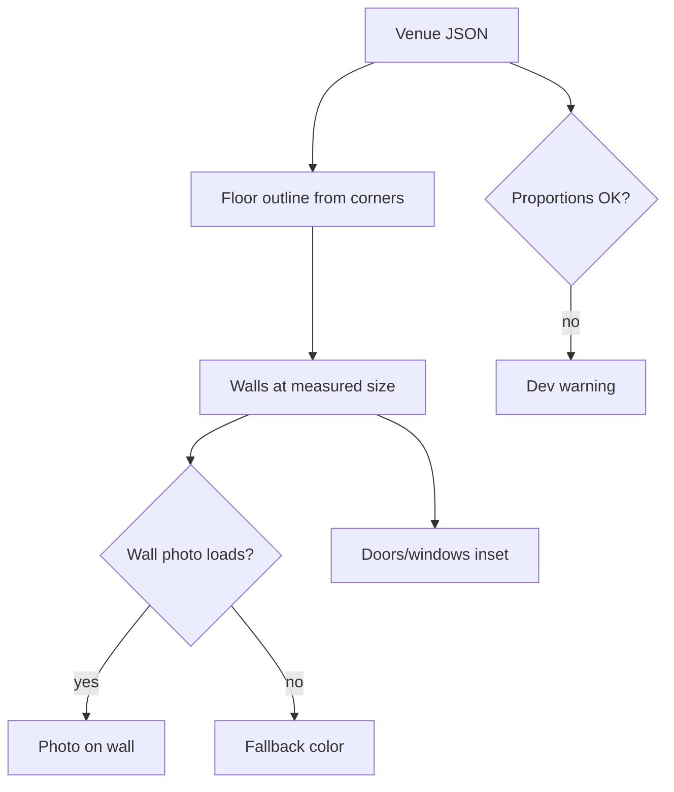

# FEAT-01: Measured venue room

| Field | Value |
|-------|-------|
| ID | FEAT-01 |
| Wave | A |
| Status | `ready` |
| Flows | [FLOW-04](../FLOWS.md#flow-04-artist-prepares-a-venue-p1) steps 2–3 |
| Depends on | FEAT-00 |
| Blocks | FEAT-02, FEAT-03, FEAT-05, FEAT-06 |
| Primary persona | **P1** Alex (enters data) · P2 Dana (recognizes her room) |

## Outcome

A venue's room is built in 3D from tape measurements: floor outline, ceiling height, walls with the artist's photos as their surfaces, and doors/windows marked. The owner recognizes it as their space.

## Persona lens

- **P1:** No floor plans exist, so a tape measure and phone photos must be enough. Filling in the venue file should feel like filling in a form.
- **P2:** "That's my bar wall." Recognition matters more than photorealism.

## User stories

- (P1) As Alex, I want to type in my room measurements and drop in wall photos so that the room exists in 3D without any 3D skills.
- (P2) As Dana, I want to recognize my own walls so that I trust what I'm seeing.

## Requirements

| ID | Requirement | Trace |
|----|-------------|-------|
| REQ-01-01 | Build floor + walls from `corners[]` (inches, clockwise); `ceilingIn` sets default wall height (open top, no ceiling cap mesh) | PRD §7 data model; D-05 |
| REQ-01-01b | Wall heights: default `ceilingIn`; per-wall `heightIn` override; sloped walls via `heightLeftIn` / `heightRightIn`; `soffits[]` drawn as lowered sections (bulkheads/beams) at the top of the wall | PRD § Data model; venue-to-venue and in-room variation |
| REQ-01-02 | Walls get stable ids/labels from the venue file (`bar-wall`, `booth-wall`…) | FLOW-04 step 3 |
| REQ-01-03 | Wall photo stretched to the wall's real width × height; plain color fallback (venue-level `wallColor`) if missing or failed | FLOW-04 step 2; shared rule 6 |
| REQ-01-04 | Openings (doors, windows) per wall: `fromLeftIn`, `fromFloorIn`, `widthIn`, `heightIn`; drawn as darker insets | FLOW-04 step 2 |
| REQ-01-04b | Per-wall keep-clear data: `wainscotIn`, `furnitureTopIn` (both optional). Dev overlay (`?debug`, arrange mode) shades the keep-clear zone + clearance band on each wall | PRD § Hang height; D-09 |
| REQ-01-04c | Optional `fixtures[]` (bar, counter, host stand) as simple boxes against a wall, so lengths like "bar ≈ 14 ft" can be checked against photos | VENUE-CAPTURE § Iterate |
| REQ-01-04d | `?debug` shows each wall's width/height labels; values listed in `estimated[]` show an **est.** badge | VENUE-CAPTURE § Iterate |
| REQ-01-05 | Units: inches in data → meters in scene (1 in = 0.0254 m) in one helper | D-04 |
| REQ-01-06 | Validation on load (dev): warn in console + on-screen dev banner if a wall's photo aspect ratio differs > 10 % from its measured size, or an opening falls outside its wall | PRD §9 risk |
| REQ-01-07 | Soft, even lighting (ambient + one directional); no shadows in `low` | PRD §6.1 |
| REQ-01-08 | Template `app/src/data/venues/_template.json` with comments in the capture guide | VENUE-CAPTURE |
| REQ-01-09 | Temporary dev camera: orbit controls to inspect the room (replaced for owners by FEAT-03) | — |

## Acceptance criteria

- (P1) **Given** the sample rectangle venue, **when** loaded, **then** walls measure 20 ft and 15 ft and wall tops match `ceilingIn` (check with a dev ruler readout).
- (P1) **Given** two venues with different `ceilingIn`, **when** each is loaded, **then** each room's walls use its own height.
- (P1) **Given** a bar wall with a soffit (`dropIn: 18` over 12 ft), **when** loaded, **then** that section of wall is 18 in shorter and the debug view labels it.
- (P1) **Given** a wall photo, **when** loaded, **then** it fills the wall without visible distortion when the aspect ratio matches.
- (P1) **Given** a photo with the wrong proportions, **when** loaded in dev, **then** a warning names the wall.
- (P1) **Given** a wall with `furnitureTopIn: 44`, **when** the debug overlay is on, **then** the wall is shaded from the floor to 54 in (44 + 10 in clearance).
- **Given** a missing photo, **when** loaded, **then** that wall shows the fallback color and the room still works.
- (P2) **Given** a real venue file, **when** Dana looks at it, **then** she can identify her walls.

## Out of scope

Vaulted/curved ceilings and multiple floor levels (approximate with slopes and soffits; FEAT-06 scans show the real shape). 3D furniture/booths (the wall photo already shows them; their height is captured as `furnitureTopIn`), realistic lighting, scans (FEAT-06).

## Decisions

D-04 units · D-05 room shape: see [FEATURES.md](../FEATURES.md#decisions-blocking-ready).

## Flow map

## Build handoff

- [ ] Read [docs/VENUE-CAPTURE.md](../docs/VENUE-CAPTURE.md)
- [ ] Test with the sample room, then with real measurements from restaurant #1
