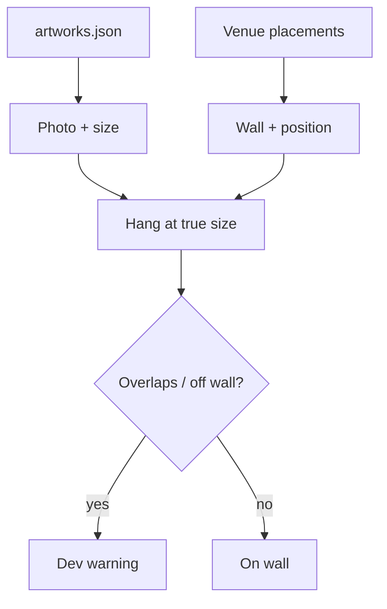

# FEAT-02: Artwork to scale

| Field | Value |
|-------|-------|
| ID | FEAT-02 |
| Wave | A |
| Status | `building` |
| Flows | [FLOW-04](../FLOWS.md#flow-04-artist-prepares-a-venue-p1) step 4 |
| Depends on | FEAT-01 |
| Blocks | FEAT-04, FEAT-05 |
| Primary persona | **P1** Alex (adds work) · P2 Dana (judges fit) |

## Outcome

Each artwork, from a photo plus its width × height, hangs on its assigned wall at exactly the right size and position.

## Persona lens

- **P1:** Adding a piece = one photo + a few numbers. The photo must look like the real piece.
- **P2:** Size is the main question ("is it too small for that wall?"). It must be true.

## User stories

- (P1) As Alex, I want to add a piece with a photo and its size so that it appears correctly without 3D work.
- (P2) As Dana, I want to see the real size of each piece on my wall so that I can judge if it fits.

## Requirements

| ID | Requirement | Trace |
|----|-------------|-------|
| REQ-02-01 | `artworks.json`: `id`, `title`, `medium`, `widthIn`, `heightIn`, optional `depthIn` (default 1.5), optional `frame` (`none` or a color + width in inches), `image` | PRD §7 |
| REQ-02-02 | Render as a thin box (canvas depth) with the photo on the front; frame drawn if set; exact outer size = width × height (+ frame) | FR-5 |
| REQ-02-03 | Venue `placements[]` positions each piece: `wallId`, `centerFromLeftIn`, optional `centerFromFloorIn`. If omitted, use the **recommended center** from the wall's keep-clear zone (one shared helper, also used by arrange mode) | D-09; PRD § Hang height |
| REQ-02-04 | Pieces sit flush on the wall (no z-fighting) and face into the room | — |
| REQ-02-05 | Dev validation: warn if a piece overlaps an opening or another piece, goes off the wall, dips into the keep-clear zone + clearance, or comes within `topMarginIn` of the top of the wall at that spot (ceiling, slope, or soffit). If the recommended center doesn't fit there, center the piece in the available space and warn if it still doesn't fit | FLOW-05 step 4; PRD § Hang height |
| REQ-02-06 | Image handling: max 2048 px long edge (1024 in `low`); dev warning if the photo's aspect ratio differs > 3 % from width × height | PRD §6.1 |
| REQ-02-07 | Same artwork can appear in multiple venues (library shared; placements per venue) | CONCEPT: Later |

## Acceptance criteria

- (P1) **Given** a 24 × 36 in piece on a wall with booth backs at 44 in and no `centerFromFloorIn`, **when** viewed, **then** its center is at 72 in, its bottom edge at 54 in, and it measures 24 × 36 in with the dev ruler.
- (P1) **Given** a wall with no wainscot or furniture, **when** a piece has no `centerFromFloorIn`, **then** it centers at 57 in.
- (P1) **Given** a piece whose bottom is below the clearance line, **when** loaded in dev, **then** a warning names the piece and the wall.
- (P1) **Given** a photo with wrong proportions, **when** loaded in dev, **then** a warning names the artwork.
- (P1) **Given** a placement overlapping a window, **when** loaded in dev, **then** a warning names both.
- (P2) **Given** the sample room, **when** Dana looks at a wall, **then** the art reads as a believable real size.

## Out of scope

Glare/glass effects, 3D sculpture (later: GLB), in-app uploads.

## Flow map

## Build handoff

- [ ] Photograph 2–3 real pieces per [docs/ASSET-PIPELINE.md](../docs/ASSET-PIPELINE.md)
- [ ] Wave A demo: one real wall + real art, to scale
