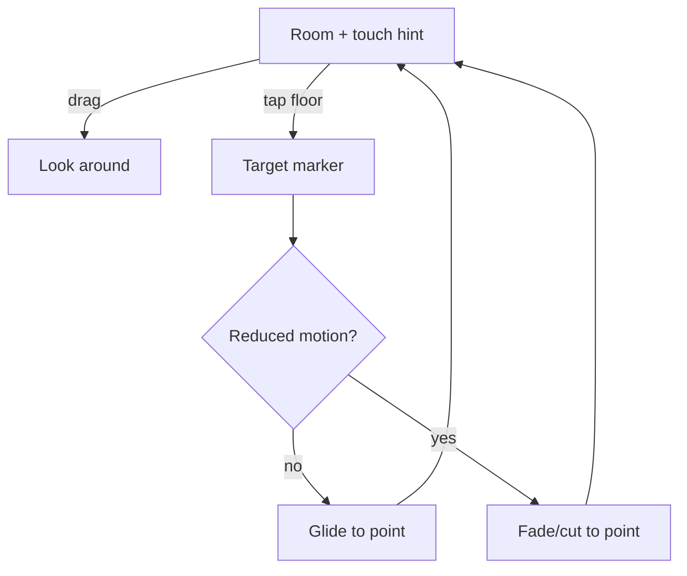

# FEAT-02: Touch movement

| Field | Value |
|-------|-------|
| ID | FEAT-02 |
| Wave | A |
| Status | `draft` |
| Flows | [FLOW-01](../FLOWS.md#flow-01--move--explore) |
| Depends on | FEAT-00, FEAT-01 (shared collision) |
| Blocks | FEAT-03 (touch selection) |
| Primary persona | **P2** Mia |

## Outcome

On phones and tablets, the visitor looks around by dragging and moves by tapping the floor (and optionally a virtual joystick), using the same collision as desktop.

## Persona lens

- **P2:** One-handed, no tutorial needed; big targets; tapping the floor should "just go there".

## User stories

- (P2) As Mia, I want to drag to look and tap the floor to walk there so that I can explore with one thumb.
- (P2) As Mia, I want controls that don't cover the art so that I can actually see the gallery.

## Requirements

| ID | Requirement | Trace |
|----|-------------|-------|
| REQ-02-01 | Detect touch-primary devices (`pointer: coarse`) and switch input mode | FLOW-01 step 1 |
| REQ-02-02 | One-finger drag on canvas = look (yaw/pitch, clamped) | FLOW-01 step 1 |
| REQ-02-03 | Tap floor = move to that point (raycast floor; path stops at colliders); target marker shown | FLOW-01 step 1; D-05 |
| REQ-02-04 | Reduced motion: tap-to-move fades/cuts instead of gliding | Shared rule 3 |
| REQ-02-05 | Optional virtual joystick (bottom-left, ≥ 44px, `aria-hidden` canvas control with visible label) | D-05 |
| REQ-02-06 | Prevent page scroll/zoom gestures on the canvas only (`touch-action: none`), not on HTML chrome | ui-patterns |
| REQ-02-07 | Reuse FEAT-01 collision | FLOW-01 step 2 |

## Acceptance criteria

- (P2) **Given** a phone, **when** Mia drags on the canvas, **then** the view turns and the page doesn't scroll.
- (P2) **Given** a phone, **when** Mia taps the floor, **then** she moves there and stops at walls.
- **Given** reduced motion, **when** tapping the floor, **then** the move is a cut/fade.

## Out of scope

Pinch zoom in the 3D scene, gyroscope look.

## Flow map

## Build handoff

- [ ] Read this file + FLOW-01 + shared rules
- [ ] Confirm D-05
- [ ] Test on real iOS Safari + Android Chrome (not just devtools emulation)
