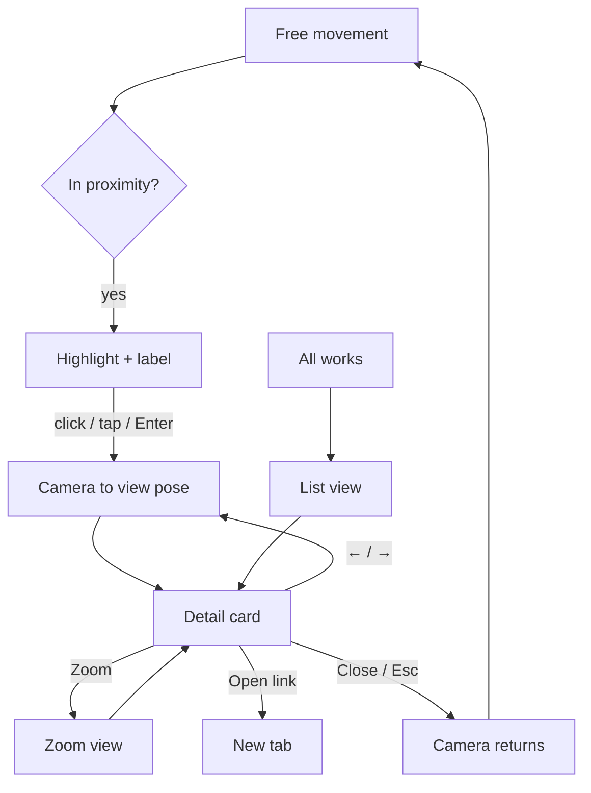

# FEAT-03: Artwork detail flow + list view

| Field | Value |
|-------|-------|
| ID | FEAT-03 |
| Wave | B |
| Status | `draft` |
| Flows | [FLOW-02](../FLOWS.md#flow-02--artwork-detail), [FLOW-03](../FLOWS.md#flow-03--list-view-fallback--shortcut) |
| Depends on | FEAT-00, FEAT-01, FEAT-02 |
| Blocks | FEAT-05 |
| Primary persona | Both |

## Outcome

Approaching an artwork lights it up; selecting it frames it head-on and opens a detail card. The same content is available from an accessible list view.

## Persona lens

- **P1:** Get to the story fast; keyboard next/previous to skim; list view to jump.
- **P2:** Tap a piece, read a readable card, close easily.

## User stories

- (Both) As a visitor, I want the nearest piece to light up so that I know what I can interact with.
- (Both) As a visitor, I want selecting a piece to frame it and show its details so that I can appreciate and understand it.
- (P1) As Riley, I want to skim pieces with ←/→ and jump from a list so that I can review quickly.

## Requirements

| ID | Requirement | Trace |
|----|-------------|-------|
| REQ-03-01 | Proximity trigger (radius per artwork in data) highlights the nearest artwork: light increase + outline/label "Select to view" | FLOW-02 step 1; shared rule 6 |
| REQ-03-02 | Selection: click (crosshair raycast when pointer-locked), tap, or Enter when highlighted; invisible collider box per artwork for raycasts | FLOW-02 step 2 |
| REQ-03-03 | Camera transition to a head-on "view pose" stored per artwork (~600–900 ms ease); cut if reduced motion; movement paused | FLOW-02 step 3 |
| REQ-03-04 | Detail card as HTML `<dialog>`: title, medium, year, narrative; actions Zoom, Open link (new tab, if present), Close | FLOW-02 step 4 |
| REQ-03-05 | Dialog a11y: focus trap, labelled heading, Esc closes, focus returns to canvas; pointer lock released while open | ui-patterns § Overlays; shared rule 2 |
| REQ-03-06 | ←/→ previous/next artwork while card is open (camera moves to that piece's view pose) | FLOW-02 step 4 |
| REQ-03-07 | Close → camera returns to pre-selection pose → free movement | FLOW-02 step 5 |
| REQ-03-08 | List view ("All works" in chrome): thumbnails, title, medium; opens same card; "View in gallery" jumps to piece when 3D is available | FLOW-03 |
| REQ-03-09 | Card layout passes 320 / 390 / 1280 checks; text never over the canvas without a solid/blurred surface | ui-patterns |

## Acceptance criteria

- **Given** I'm within range of a frame, **when** I look at it, **then** it brightens and shows "Select to view".
- **Given** a highlighted frame, **when** I click/tap/press Enter, **then** the camera frames it and the card opens with focus inside.
- **Given** the card is open, **when** I press Esc, **then** it closes and I'm back where I was.
- (P1) **Given** the card is open, **when** Riley presses →, **then** the next artwork is framed and its card shows.
- **Given** reduced motion, **when** selecting, **then** the camera cuts instead of flying.
- **Given** 3D is unavailable, **when** I open "All works", **then** every artwork card is readable.

## Out of scope

Real splat/GLB assets (placeholder images on planes for now — FEAT-04), share links/deep links (later).

## Flow map

## Build handoff

- [ ] Read this file + FLOW-02/03 + shared rules
- [ ] Use placeholder images from `app/public/placeholder/`
- [ ] Run **accessibility-audit** skill on the dialog and list view
