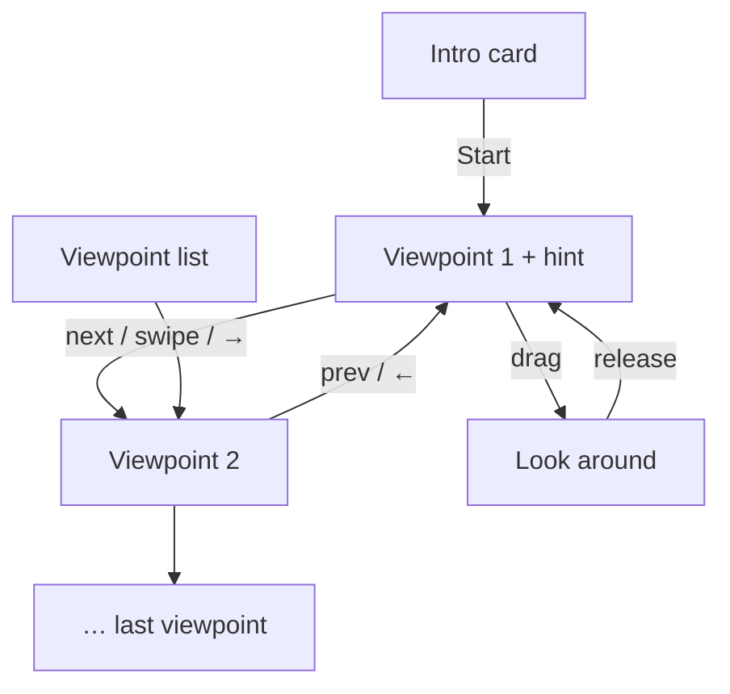

# FEAT-03: Viewpoints (owner navigation)

| Field | Value |
|-------|-------|
| ID | FEAT-03 |
| Wave | B |
| Status | `ready` |
| Flows | [FLOW-00](../FLOWS.md#flow-00-owner-opens-the-pitch-p2) steps 4–5, [FLOW-01](../FLOWS.md#flow-01-owner-looks-around-p2) |
| Depends on | FEAT-01, FEAT-02 |
| Blocks | FEAT-04, FEAT-05 (save viewpoint) |
| Primary persona | **P2** Dana |

## Outcome

The owner taps through a few named views of their room ("Bar wall", "Booths") and can drag to look around a little. No game controls, nothing to learn.

## Persona lens

- **P2:** One hand, between services. Big, labelled buttons; swipe works; you can't get lost.
- **P1:** Alex picks the best angles (like framing a photo) so every view sells.

## User stories

- (P2) As Dana, I want to tap "next" to see each wall so that I see everything without figuring out controls.
- (P2) As Dana, I want to look around a little so that I can see the art in context with the room.
- (P1) As Alex, I want to set which views appear and in what order so that the pitch tells a story.

## Requirements

| ID | Requirement | Trace |
|----|-------------|-------|
| REQ-03-01 | Venue `viewpoints[]` (`id`, `label`, `position`, `lookAt`) in inches; order = pitch order | PRD §7 |
| REQ-03-02 | Intro card: "Artwork by {artistName} for *{venue name}*" + **Start** (focus on Start). `artistName` comes from `app/src/data/site.json` ("Alex Farrell"), not hard-coded | FLOW-00 step 4; D-13 |
| REQ-03-03 | Viewpoint bar at bottom: ‹ prev · label "2 of 4 · Bar wall" · next ›, plus tappable list of names; targets ≥ 44 px | FLOW-01 step 1 |
| REQ-03-04 | Change viewpoint by tap, horizontal swipe, or ←/→; camera glides ~700 ms (cut/fade if reduced motion) | FLOW-01 step 2; shared rule 4 |
| REQ-03-05 | Drag to look: yaw ±35°, pitch ±15° from the viewpoint; eases back on release; no zoom/walk | FLOW-01 step 3 |
| REQ-03-06 | One-time hint, dismissed on first interaction | FLOW-00 step 5; shared rule 1 |
| REQ-03-07 | Camera eye height per viewpoint: default 63 in (standing); `eyeHeightIn: 48` for **seated** views ("From the booths") so the owner sees what diners see. Field of view tuned so a typical wall fits on a phone in portrait | PRD § Hang height |
| REQ-03-08 | Fallback when a venue has no viewpoints: auto-generate one per wall that has art (centered, facing the wall) | Shared rule 6 |
| REQ-03-09 | Replaces FEAT-01's dev orbit camera for owners; orbit kept behind `?debug` | — |

## Acceptance criteria

- (P2) **Given** the intro card, **when** Dana taps Start, **then** the first viewpoint shows with the hint.
- (P2) **Given** any viewpoint, **when** Dana swipes left or taps ›, **then** the next named view shows; the label updates.
- (P2) **Given** a drag, **when** released, **then** the view eases back and can't flip or leave the room.
- **Given** reduced motion, **when** changing views, **then** it cuts/fades.
- **Given** a keyboard, **when** pressing ←/→ or tabbing to the bar, **then** all views are reachable.
- **Given** no viewpoints in the file, **when** loaded, **then** one view per art wall is generated.

## Out of scope

Free walking, zoom, VR, autoplay tours.

## Flow map

## Build handoff

- [ ] Test one-handed on a real phone in portrait
- [ ] Run **interaction-design** skill on the viewpoint bar
