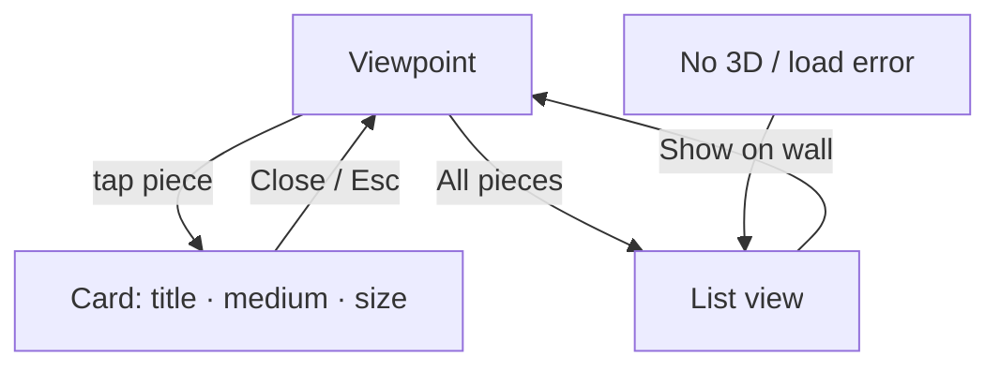

# FEAT-04: Artwork info card + list view

| Field | Value |
|-------|-------|
| ID | FEAT-04 |
| Wave | B |
| Status | `ready` |
| Flows | [FLOW-02](../FLOWS.md#flow-02-owner-checks-a-piece-p2), [FLOW-03](../FLOWS.md#flow-03-list-view-p2-fallback--shortcut) |
| Depends on | FEAT-02, FEAT-03 |
| Primary persona | **P2** Dana |

## Outcome

Tapping a piece shows its title, medium, and size. An "All pieces" list shows every piece in the pitch and is also the fallback when 3D can't run.

## Persona lens

- **P2:** Quick facts, readable at arm's length. Size in plain words.

## User stories

- (P2) As Dana, I want to tap a piece to see what it is and how big it is so that I can picture it for real.
- (P2) As Dana, I want a simple list of all the pieces so that I can review them in one place or share them with a partner.

## Requirements

| ID | Requirement | Trace |
|----|-------------|-------|
| REQ-04-01 | Tap/click a piece (raycast) or Enter when focused → outline + card | FLOW-02 step 1; shared rule 7 |
| REQ-04-02 | Card content: **title**, **medium**, **size** formatted "24 × 36 in" (+ "framed" if frame); nothing else in v1 | D-10; shared rule 9 |
| REQ-04-03 | Card as bottom sheet on phone, side panel on desktop; `<dialog>` semantics: labelled heading, focus moves in, Esc/Close/tap outside closes, focus returns | FLOW-02 steps 2–3; ui-patterns § Overlays |
| REQ-04-04 | Viewpoint bar hidden or disabled while the card is open | — |
| REQ-04-05 | Pieces are focusable in tab order (hidden HTML buttons mapped to 3D positions) with accessible names "Title, 24 × 36 in" | ux-principles § 3D |
| REQ-04-06 | "All pieces" button → list: image, title, medium, size, wall label; "Show on wall" jumps to the viewpoint showing it | FLOW-03 |
| REQ-04-07 | List view works without 3D (used by FEAT-00 fallback and error) | Shared rule 5 |
| REQ-04-08 | Run **ux-writing** skill for card + list copy | ux-principles |

## Acceptance criteria

- (P2) **Given** a viewpoint with art, **when** Dana taps a piece, **then** a card shows its title, medium, and "W × H in".
- **Given** the card is open, **when** Esc / Close / tap outside, **then** it closes and the same view remains.
- **Given** a keyboard, **when** tabbing, **then** each piece can be focused and opened.
- (P2) **Given** "All pieces", **when** Dana taps "Show on wall", **then** the matching viewpoint shows with that piece outlined.
- **Given** no WebGL2, **when** the link opens, **then** the list shows every piece with size.

## Out of scope

Story, price, availability, contact button, swapping art (later; see D-10).

## Flow map

## Build handoff

- [ ] Run **accessibility-audit** skill on the card and list
- [ ] Wave B demo: send restaurant #1 the link
