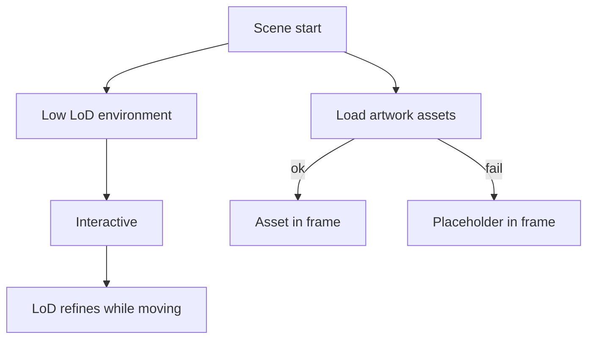

# FEAT-04: Splat environment + artwork assets

| Field | Value |
|-------|-------|
| ID | FEAT-04 |
| Wave | C |
| Status | `draft` |
| Flows | [FLOW-00](../FLOWS.md#flow-00--arrive--load), [FLOW-01](../FLOWS.md#flow-01--move--explore) |
| Depends on | FEAT-00, FEAT-03; 3–5 processed assets ([ASSET-PIPELINE](../docs/ASSET-PIPELINE.md)) |
| Blocks | FEAT-06 |
| Primary persona | Both |

## Outcome

Real captured content replaces the gray box: a Gaussian-splat environment (and/or splat/GLB artworks) streams in with level-of-detail, while collision and selection keep working.

## Persona lens

- **P1:** High fidelity on desktop is the "wow".
- **P2:** Must still load and run on a phone — lower detail is fine; a stall is not.

## User stories

- (Both) As a visitor, I want the real space and artwork to appear progressively so that I can start exploring before everything finishes loading.

## Requirements

| ID | Requirement | Trace |
|----|-------------|-------|
| REQ-04-01 | Add Spark (`@sparkjsdev/spark`); one `SparkRenderer` in the scene; `WebGLRenderer` with `antialias: false` | PRD §7; D-01 |
| REQ-04-02 | Load environment splat (`.spz` preferred, `.ply` ok) from hosted URL with LoD enabled | PRD FR-10 |
| REQ-04-03 | Artwork assets from `artworks.ts`: `type` (`image`, `splat`, or `glb`) + URL; placeholders remain as fallback | REQ-00-04 |
| REQ-04-04 | Gray-box walls become invisible colliders aligned to the splat (collision unchanged) | FEAT-01 REQ-01-03 |
| REQ-04-05 | Artwork colliders for raycast stay aligned to new assets | FEAT-03 REQ-03-02 |
| REQ-04-06 | Progressive load: interactive with low LoD first; progress UI covers initial chunk only | FLOW-00 step 3 |
| REQ-04-07 | Asset load failure for one artwork shows its placeholder + card still works | Shared rule 5 |
| REQ-04-08 | Quality tiers from REQ-00-11 drive Spark: `lodSplatScale` (low ≈ 0.3, medium ≈ 0.6, high = 1.0), `lodRenderScale`, DPR cap. Auto-pick by device in production | PRD §6.1 (moved up from FEAT-06) |

## Acceptance criteria

- **Given** the live URL on desktop, **when** it loads, **then** the splat environment appears and sharpens as I move.
- **Given** a phone, **when** it loads, **then** I can move within the FEAT-06 time budget even if detail is lower.
- **Given** one artwork URL 404s, **when** the scene loads, **then** that frame shows its placeholder and its card opens.
- **Given** the dev laptop in `low` quality, **when** walking the splat environment, **then** movement stays smooth (no multi-second freezes).

## Out of scope

Editing/cleaning splats in code (done in cloud tools), WebGPU path.

## Decisions

D-06 setting (portfolio vs restaurant) · D-07 splat source — see [FEATURES.md](../FEATURES.md#decisions-blocking-ready).

## Flow map

## Build handoff

- [ ] Assets exported + hosted per ASSET-PIPELINE
- [ ] Read this file + Spark docs ([sparkjs.dev](https://sparkjs.dev/docs/))
- [ ] Re-run FEAT-01/02/03 acceptance criteria (regression)
