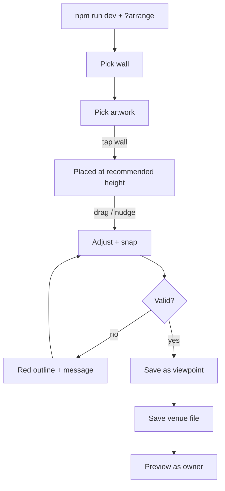

# FEAT-05: Arrange mode (artist)

| Field | Value |
|-------|-------|
| ID | FEAT-05 |
| Wave | C |
| Status | `building` |
| Flows | [FLOW-05](../FLOWS.md#flow-05-artist-arranges-art-p1-arrange-mode) |
| Depends on | FEAT-02, FEAT-03 |
| Primary persona | **P1** Alex |

## Outcome

Alex arranges art on a venue's walls by picking a wall, tapping to place, and dragging to adjust, then saves views, all without editing files. Saving writes the venue file, ready to commit.

## Persona lens

- **P1:** Feels like arranging frames on a mood board, not like 3D software. Numbers visible for precision (inches from left / from floor).
- **P3 (future):** Same tool, any artist. Keep it simple.

## User stories

- (P1) As Alex, I want to tap a wall to place a piece and drag it into position so that I can try arrangements quickly.
- (P1) As Alex, I want guides for centering and even spacing so that the layout looks professionally hung.
- (P1) As Alex, I want to save the current camera as a named viewpoint so that the owner sees my best angles.

## Requirements

| ID | Requirement | Trace |
|----|-------------|-------|
| REQ-05-01 | Only available in `npm run dev` with `?arrange`; never in production builds | Shared rule 8; D-06 |
| REQ-05-02 | Side panel: wall list (with W × H), artwork library (thumbnails + sizes), selected-piece readout | FLOW-05 steps 2–3 |
| REQ-05-03 | Select wall → camera faces wall straight-on; wall dimensions shown | FLOW-05 step 2 |
| REQ-05-04 | Select artwork → tap wall to place: horizontal = tapped spot, vertical = **recommended center** for that wall and piece | FLOW-05 step 3; D-09 |
| REQ-05-04b | Wall panel shows and edits `wainscotIn` / `furnitureTopIn`; keep-clear zone shaded on the wall while arranging | PRD § Hang height |
| REQ-05-05 | Drag to move on the wall plane; arrow keys nudge 1 in (Shift = 6 in); readout "from left / from floor" in inches, editable fields; **Reset height** returns to recommended | FLOW-05 step 4 |
| REQ-05-06 | Snap guides: wall center, recommended-center line, align with neighbor edges/centers, equal spacing, **shared center line** across pieces on the same wall | FLOW-05 step 4 |
| REQ-05-07 | Invalid placement (over opening, off wall, overlapping, into keep-clear zone, too close to ceiling) → red outline + text message; Save blocked for that piece (keep-clear can be overridden with a confirm, e.g. above a bar) | FLOW-05 step 4; shared rule 7 |
| REQ-05-08 | Remove piece; swap piece (keeps center position) | FLOW-05 step 5 |
| REQ-05-09 | Free camera in arrange mode (orbit); **Save as viewpoint** with a name; reorder/delete viewpoints | FLOW-05 step 6 |
| REQ-05-10 | **Save** writes `venues/<id>.json` via a small Vite dev-server endpoint; success/failure message; unsaved-changes warning | FLOW-05 step 7; D-06 |
| REQ-05-11 | **Preview as owner** toggle shows exactly the FEAT-03/04 experience | FLOW-04 step 6 |

## Acceptance criteria

- (P1) **Given** arrange mode, **when** Alex selects the booth wall (booth backs 44 in) and a 24 × 36 piece and taps the wall, **then** it appears there at true size, centered at 72 in, with its readout.
- (P1) **Given** a piece dragged down into the shaded zone, **when** released, **then** it shows red with "Too low: clears the booths by 4 in (10 in recommended)".
- (P1) **Given** a dragged piece near wall center, **when** within 1 in, **then** it snaps and the guide shows.
- (P1) **Given** a piece over a window, **when** Alex tries to save, **then** Save explains which piece is invalid.
- (P1) **Given** Save, **when** it succeeds, **then** the venue JSON on disk reflects the layout and viewpoints (visible in Cursor's source control panel).
- **Given** a production build, **when** `?arrange` is added, **then** nothing changes.

## Out of scope

In-app uploads of new artwork, multi-user editing, undo history beyond one step (nice-to-have).

## Flow map

## Build handoff

- [ ] Run **design-critique** skill on the arrange panel
- [ ] Wave C demo: arrange restaurant #2 from scratch
