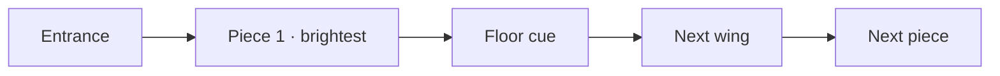

# FEAT-05: Spatial wayfinding

| Field | Value |
|-------|-------|
| ID | FEAT-05 |
| Wave | D |
| Status | `draft` |
| Flows | [FLOW-01](../FLOWS.md#flow-01--move--explore) step 3 |
| Depends on | FEAT-01, FEAT-03 (FEAT-04 for final look) |
| Primary persona | Both |

## Outcome

Visitors are drawn naturally from piece to piece and wing to wing by light, floor cues, and optional sound — without a map overlay.

## Persona lens

- **P1:** Short visit — the path should reveal the strongest pieces first.
- **P2:** No reading required; the brightest spot is "next".

## User stories

- (Both) As a visitor, I want subtle cues toward the next piece so that I don't get lost or miss work.

## Requirements

| ID | Requirement | Trace |
|----|-------------|-------|
| REQ-05-01 | Curated visit order in `artworks.ts` (`order` field) | FLOW-01 step 3 |
| REQ-05-02 | Light pools / spotlights on artworks; unvisited pieces slightly brighter | FLOW-01 step 3 |
| REQ-05-03 | Floor cue (pattern, runner, or light strip) leading between wings | FLOW-01 step 3 |
| REQ-05-04 | Optional ambient audio per wing: starts muted, visible toggle with label, remembers choice | Shared rule 7; D-08 |
| REQ-05-05 | Cues never rely on color alone (also brightness/shape) | Shared rule 6 |
| REQ-05-06 | Reduced motion: no pulsing/animated cues | Shared rule 3 |

## Acceptance criteria

- **Given** a first-time visitor at the entrance, **when** they look around, **then** the first piece in order is the most prominent.
- **Given** audio is available, **when** the page loads, **then** no sound plays until the visitor turns it on.

## Out of scope

Minimap, guided tour autopilot.

## Flow map

