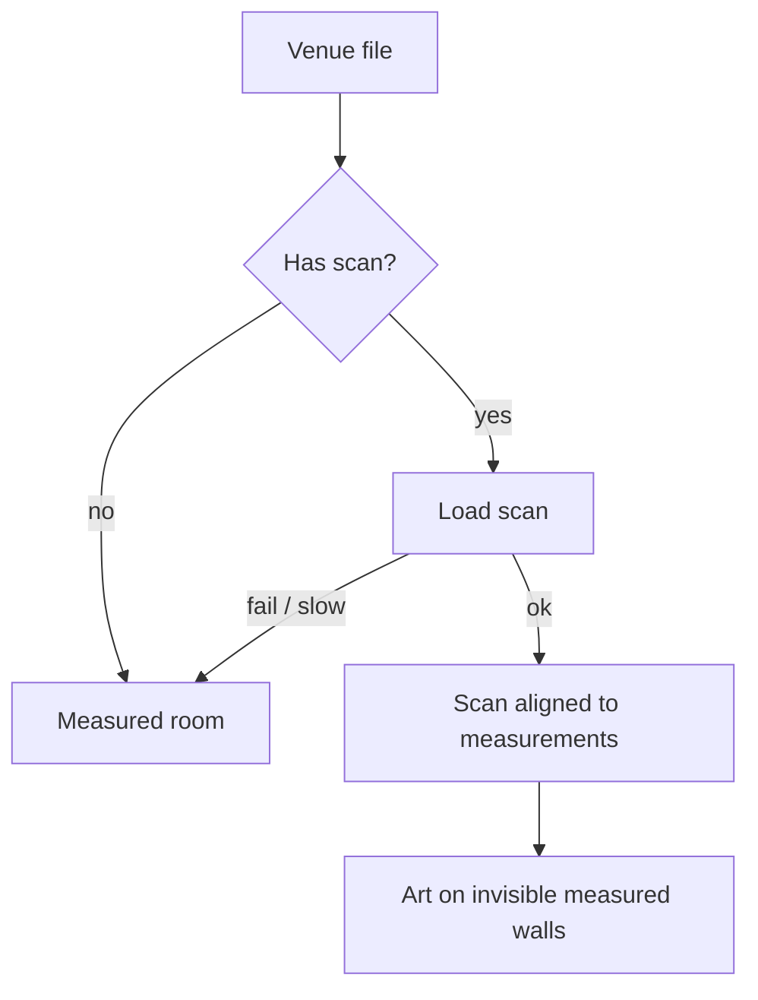

# FEAT-06: Scanned room (realism)

| Field | Value |
|-------|-------|
| ID | FEAT-06 |
| Wave | D |
| Status | `building` |
| Flows | [FLOW-00](../FLOWS.md#flow-00-owner-opens-the-pitch-p2), [FLOW-04](../FLOWS.md#flow-04-artist-prepares-a-venue-p1) step 2 |
| Depends on | FEAT-01…05; a processed scan per [ASSET-PIPELINE](../docs/ASSET-PIPELINE.md) |
| Primary persona | Both |

## Outcome

Optionally, a venue shows a realistic scan of the room (a Gaussian splat made in the cloud from a phone video) instead of photo walls. Art still hangs at true scale because the scan is aligned to the measured room.

## Persona lens

- **P2:** "Wow, that's really my restaurant," with the furniture, light, and mood.
- **P1:** Optional per venue; the measured room always remains as the backup.

## User stories

- (P2) As Dana, I want to see my actual room, with booths and lighting, so that I can picture the art in the real atmosphere.
- (P1) As Alex, I want to add a scan without redoing my layout so that realism is a bonus, not a rebuild.

## Requirements

| ID | Requirement | Trace |
|----|-------------|-------|
| REQ-06-01 | Add Spark (`@sparkjsdev/spark`): one `SparkRenderer`; `WebGLRenderer` with `antialias: false` | PRD §7; D-01 |
| REQ-06-02 | Venue `scan` field: URL (`.spz` preferred / `.ply`), plus `scale`, `rotation`, `offset` to align with the measured room | FR-9 |
| REQ-06-03 | Measured walls become invisible (still used for art placement, raycasts, arrange mode) when a scan is shown | — |
| REQ-06-04 | Alignment helper in arrange mode: show measured walls as outlines over the scan; adjust scale/rotation/offset with fields; save to venue file | FLOW-05 |
| REQ-06-05 | Quality tiers drive Spark: `lodSplatScale` (low ≈ 0.3, medium ≈ 0.6, high = 1.0), `lodRenderScale`, pixel-ratio cap | PRD §6.1 |
| REQ-06-06 | Scan fails or is too slow (> 10 s) → fall back to measured room automatically | Shared rule 6 |
| REQ-06-07 | Toggle for owners only if useful: "Realistic view / Simple view" (default realistic when available) | D-12 |

## Acceptance criteria

- (P2) **Given** a venue with a scan, **when** opened on a phone, **then** the realistic room shows and art sits on the walls at true size.
- (P1) **Given** the alignment helper, **when** outlines match the scan, **then** saved values persist.
- **Given** the scan URL fails, **when** opened, **then** the measured room shows instead, without an error screen.
- **Given** the dev laptop in `low`, **when** viewing the scan, **then** it stays responsive.

## Out of scope

Editing/cleaning scans in code (done in the cloud tool), WebGPU.

## Decisions

D-07 scan source: see [FEATURES.md](../FEATURES.md#decisions-blocking-ready).

## Flow map

